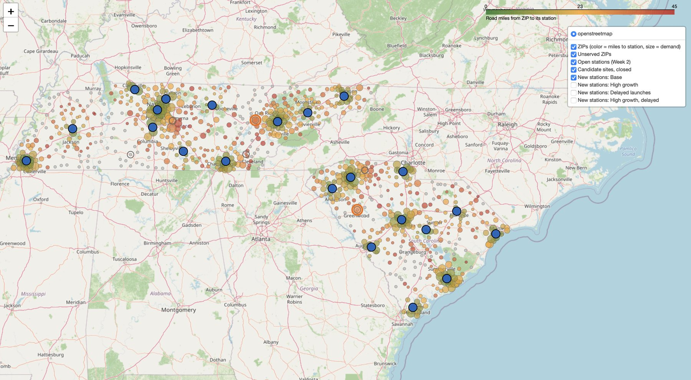
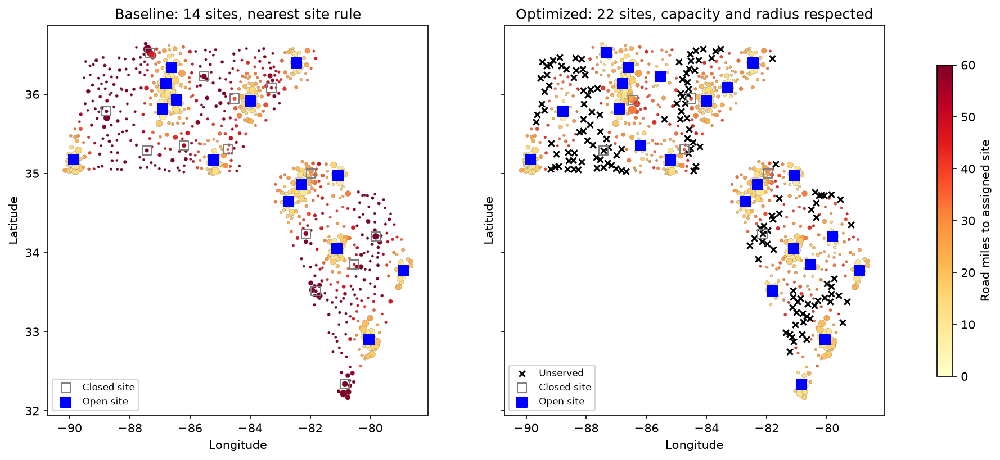
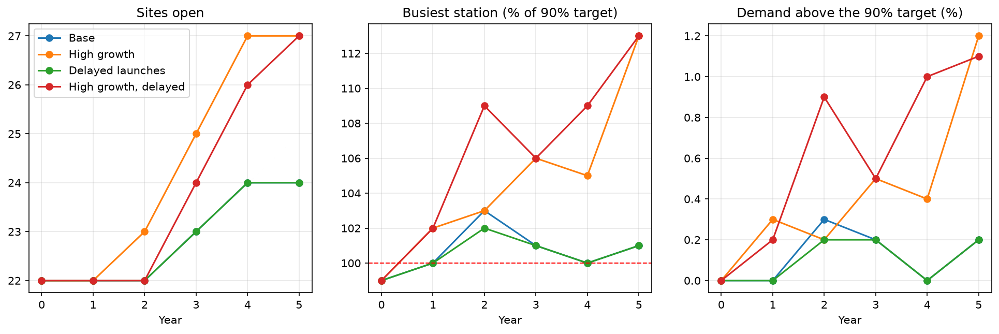

# Delivery Station Topology Planner

A model that plans where last mile delivery stations should go in Tennessee and South Carolina, which ZIP codes each station serves, and when new stations should open as demand grows.

I built it as a supply chain portfolio project. It uses public Census data and placeholder assumptions that I chose and tested. It does not use Amazon data, and it does not describe any real company's network.

**[Open the interactive map](https://abhishekambekar.github.io/Topology-Planner/)** (hover over any ZIP or station, and switch layers on the right)



## The question

If you had to serve 835 ZIP codes across two states from a set of 28 possible station sites, which sites would you open? How would you split the ZIPs between them without overloading any station? And as demand grows over five years, which new stations would you open first?

## What I found

I compared a simple layout against the model's layout on the same data.

| Measure | Simple layout | Model layout |
|---|---|---|
| Stations open | 14 | 22 |
| Average road miles to station | 24.7 | 15.5 |
| Longest trip, miles | 135.8 | 45.0 |
| Demand served within 45 miles | 81.3% | 95.1% |
| Stations over capacity | 5 | 0 |
| Busiest station use | 115% | 99% |

The simple layout opens the 14 busiest sites, sends each ZIP to its nearest one, and ignores capacity. It is easy to beat, so read the table as "the model meets the limits and shortens the average trip by about a third", not as a savings claim. The model leaves 5% of demand unserved on purpose, mostly in rural ZIPs. Serving them would need many small stations.



### Five year build plan

The 22 model stations are treated as the network in place today. Each year the plan can open up to 2 new stations from the 6 closed candidates. A station counts as full at 90% of capacity.

| Scenario | Demand in Year 5 (today = 100) | Stations in Year 5 | Busiest station, % of the 90% target |
|---|---|---|---|
| Base | 118 | 24 | 101 |
| High growth | 135 | 27 | 113 |
| Delayed launches (base growth) | 118 | 24 | 101 |
| High growth, delayed launches | 135 | 27 | 113 |

Two stations open in every scenario, SC-04 and TN-13, so they are the safe bets. Under base growth the network has about three years of room, so delaying launches changes nothing. Under high growth the 28 candidates run out by Year 5.



### What drives the answer

I changed one assumption at a time and counted the stations the model opened.

| Assumption | Range tested | Stations opened |
|---|---|---|
| Maximum drive radius | 60 down to 35 miles | 16 to 28 |
| Share of demand that must be served | 90% to 98% | 18 to 27 |
| Road distance factor | 1.2 to 1.4 | 20 to 24 |
| Station capacity | plus 20% to minus 20% | 22 to 25 |
| Cost to open a site | minus 20% to plus 20% | 22 to 21 |

The two service quality settings matter more than the cost settings. One example of why: at my base site cost, the model skips Murfreesboro, a high demand suburb, and serves it from a station 32 miles away. At half the site cost it opens a Murfreesboro station and the trip drops to 11.5 miles. Across the whole network the change is small, but it decides which suburbs get a local station.

## How it works

1. **Data prep** pulls Census households, income, land area and county growth for every ZIP, drops tiny ZIPs (under 500 households, 0.89% of households), and builds a demand proxy: households times an income index times a density factor.
2. **Candidate sites.** Demand weighted clustering picks 28 candidate locations, 16 in Tennessee and 12 in South Carolina, snapped to real ZIPs.
3. **Optimizer.** A capacity limited facility location model picks stations and assigns ZIPs. It uses a mixed integer program solved with SciPy's HiGHS solver.
4. **Build plan.** A year by year version keeps open stations open, adds new ones under a launch limit, and runs four growth scenarios from Census county population estimates.
5. **Packaging.** One script builds a SQL database, an Excel workbook with live formulas, and the interactive map.

## Run it yourself

Tested on Python 3.14. You need a free [Census API key](https://api.census.gov/data/key_signup.html).

```bash
python3 -m venv .venv
source .venv/bin/activate
pip install -r requirements.txt
export CENSUS_API_KEY=your_key_here

python src/data_prep.py          # downloads Census data, builds the ZIP table and candidate sites
python src/optimize.py           # base case, add --sensitivity for the what if tests
python src/build_plan.py         # five year scenarios
python src/package_outputs.py    # SQL database, Excel workbook, interactive map
python src/check_output.py       # optional quick checks on the Week 1 files
```

The first run downloads about 16 MB of Census files into `data/raw/`, which is not committed. The processed tables and all outputs are in the repo, so you can look at results without running anything.

## What is in the repo

```
src/       the five scripts above
sql/       seven SQL queries (metro summary, station load, longest trips, unserved ZIPs,
           fastest growing counties, scenario stress, new stations by year)
data/      processed tables and the SQLite database
outputs/   Excel workbook, interactive map, scenario tables, sensitivity results, charts
docs/      assumptions and limits, screenshots, and the map page for GitHub Pages
```

The Excel workbook (`outputs/topology_planner.xlsx`) has a Summary tab with a tie out that recomputes three numbers from the raw data and checks them against the model. Most figures in it are formulas, including a VLOOKUP on every ZIP row.

## Limits

The full list is in [docs/assumptions.md](docs/assumptions.md). The main ones:

- Demand is a proxy from households, income and density. No public data gives real delivery volume by ZIP.
- Capacity, site cost, radius, buffer and the online shopping trend are placeholders. Cost units are not dollars.
- Candidate sites are statistical centers, not real or available locations.
- Distances are straight line miles times 1.3, not drive times.
- Data stops at the state line, so spillover demand from Charlotte, Georgia, Mississippi and Arkansas is missing.
- All stations have the same size and cost, and the model has no delivery speed rule for dense suburbs.

## What I would do next with real data

Replace the demand proxy with real package volume, replace candidate centers with real sites that have their own capacity and cost, add two facility sizes so rural ZIPs can be served by small stations, use drive times, and add the border counties in neighboring states.

Built by Abhishek Ambekar.
